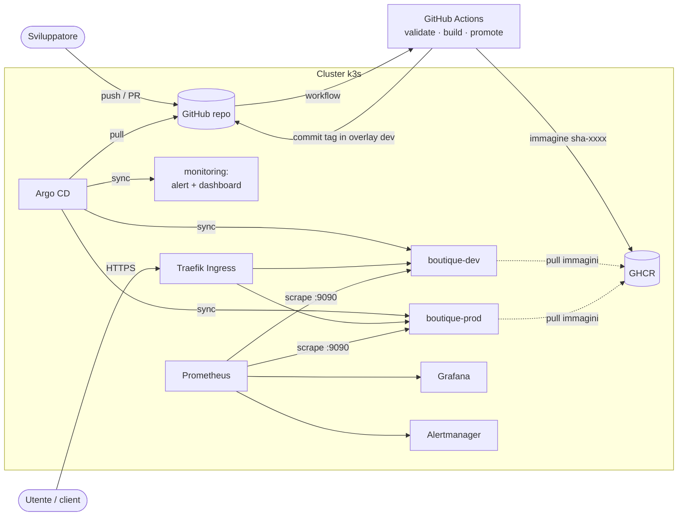
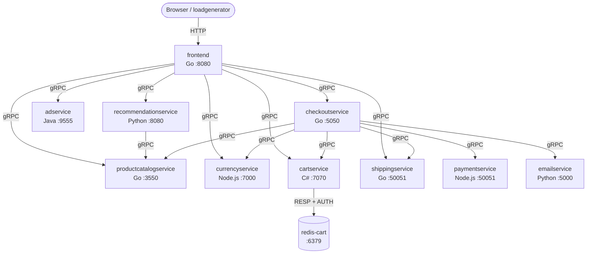
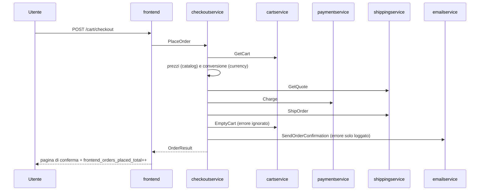
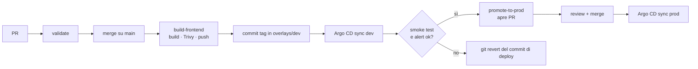

# Architettura

## Vista d'insieme

Principi:

- **Git è l'unica fonte di verità.** La CI non ha credenziali verso il cluster: costruisce, valida e scrive in Git. Argo CD applica in pull.
- **Upstream intatto.** La piattaforma sta in `platform/` e si appoggia alla base Kustomize upstream: aggiornare Online Boutique significa fare merge dell'upstream, non riscrivere manifest.
- **Ambienti come overlay.** dev e prod differiscono solo per ciò che deve differire (tabella più sotto).

## L'applicazione

| Servizio | Linguaggio | Porta | Chiama | Ruolo |
|---|---|---|---|---|
| frontend | Go | 8080 HTTP, 9090 metriche | tutti tranne payment/email | UI web, unico ingresso, sessione via cookie |
| checkoutservice | Go | 5050 | catalog, currency, cart, shipping, payment, email | Orchestratore dell'ordine |
| cartservice | C# | 7070 | redis-cart | Carrello per sessione |
| redis-cart | Redis 7.4 | 6379 | — | Stato del carrello (`emptyDir`) |
| productcatalogservice | Go | 3550 | — | Catalogo da `products.json` nell'immagine |
| currencyservice | Node.js | 7000 | — | Tassi di cambio statici |
| paymentservice | Node.js | 50051 | — | Pagamento simulato (valida la carta, restituisce un ID) |
| shippingservice | Go | 50051 | — | Preventivo e tracking simulati |
| emailservice | Python | 5000→8080 | — | Email di conferma (solo log) |
| recommendationservice | Python | 8080 | catalog | Prodotti suggeriti |
| adservice | Java | 9555 | — | Banner pubblicitari |
| loadgenerator | Python (Locust) | — | frontend | Traffico sintetico, solo in dev |

Le chiamate sono tutte **sincrone**. Gli indirizzi dei backend arrivano al frontend e al checkout come variabili d'ambiente (`*_SERVICE_ADDR`) che puntano ai Service ClusterIP: la service discovery è il DNS di cluster.

### Mappatura sui ruoli della challenge

| Ruolo richiesto | In questa soluzione |
|---|---|
| Client / API consumer | Browser, `loadgenerator`, `scripts/smoke-test.sh` |
| Ingress / Route | Ingress `frontend` su Traefik, TLS da cert-manager |
| API service | `frontend`: espone HTTP (pagine HTML e `/product-meta/{ids}` in JSON) e traduce verso i backend gRPC |
| Worker / componente asincrono | Nessuna coda nell'app. Il comportamento più vicino è `emailservice`: il checkout lo chiama dopo aver completato l'ordine e ne **ignora il fallimento** (log `Warn`). Il `loadgenerator` è un job di lunga durata. |
| Database / cache / broker | `redis-cart` |
| ConfigMap e Secret | Configurazione in env dichiarata negli overlay; dashboard Grafana in ConfigMap; password Redis nel Secret `redis-auth` |
| CI/CD / GitOps | GitHub Actions + Argo CD |
| Monitoring e logging | kube-prometheus-stack, metriche del frontend, log JSON su stdout |
| Krateo | Blueprint Helm registrabile come CompositionDefinition ([krateo.md](krateo.md)) |

Il fatto che non ci sia un vero componente asincrono va detto: introdurre una coda solo per la challenge vorrebbe dire modificare il codice di checkout ed email, fuori dal perimetro "adattamenti mirati". Se servisse, il punto naturale è la conferma email: checkout pubblica un evento, emailservice lo consuma.

### Flusso di checkout

Conseguenze operative: se cade `paymentservice` o `shippingservice` l'ordine fallisce (`frontend_orders_failed_total`). Se cade `emailservice` l'ordine passa e resta solo un warning nei log di checkout.

## Ambienti

| | dev | prod |
|---|---|---|
| Namespace | `boutique-dev` | `boutique-prod` |
| Host | `boutique-dev.homelab.local` | `boutique.homelab.local` |
| Frontend | 1 replica, `LOG_LEVEL=debug`, banner "Ambiente DEV" | HPA 2–4 su CPU, PDB `minAvailable: 1`, `maxUnavailable: 0`, `LOG_LEVEL=info` |
| Load generator | sì, 3 utenti | no |
| Immagine frontend | aggiornata dalla CI a ogni build | aggiornata solo da PR di promozione |
| RBAC team | lettura + restart/delete pod/port-forward | sola lettura |
| Sync Argo CD | automatico, prune, selfHeal | automatico, prune, selfHeal; il gate è la PR |

Entrambi hanno `ResourceQuota` e `LimitRange` (componente `guardrails`), Pod Security Admission `restricted` e le stesse NetworkPolicy.

## Configurazione e secret

- **Configurazione**: variabili d'ambiente nei Deployment, differenze per ambiente come patch negli overlay. Nessuna ConfigMap applicativa: l'app non ne usa, e introdurne una solo per spostarci le env non aggiunge valore.
- **Secret**: l'unico vero segreto è la password di Redis, che upstream non usa. Il Secret `redis-auth` è creato da `scripts/create-secrets.sh` con una password casuale generata nel cluster: non passa da Git, né dal terminale, né da un prompt AI. Redis la riceve come `--requirepass`, cartservice la compone nella stringa di connessione (`redis-cart:6379,password=$(REDIS_PASSWORD)`, espansione delle env di Kubernetes).
- **Limite e evoluzione**: il Secret non è versionato né ruotato in automatico. In un contesto reale: External Secrets Operator con Vault come backend (rotazione e audit centralizzati) oppure Sealed Secrets se si vuole tutto in Git. La rotazione manuale è documentata nel [runbook](runbook.md#rotazione-password-redis).

## Sicurezza

| Misura | Dove |
|---|---|
| Pod Security Admission `restricted` (enforce) sui namespace | `overlays/*/namespace.yaml` |
| `runAsNonRoot`, `readOnlyRootFilesystem`, `drop: [ALL]`, no privilege escalation (upstream) + `seccompProfile: RuntimeDefault` (aggiunto) | `base/patches/pod-security.yaml` |
| Un ServiceAccount per servizio (aggiunto anche a Redis), **nessun token montato**, nessun permesso API: nessun workload parla con l'API server | `base/patches/serviceaccount-no-token.yaml` |
| NetworkPolicy default-deny + allow per servizio (upstream); frontend ristretto a ingress controller, loadgenerator e Prometheus solo su :9090 | `components/network-policies` |
| `/metrics` su porta separata, non raggiungibile dall'Ingress | `src/frontend/metrics.go` |
| Frontend non esposto con LoadBalancer (componente upstream `non-public-frontend`); quota con `services.loadbalancers: 0` e `nodeports: 0` | base + `guardrails` |
| Immagini con tag fisso (`v0.10.7`, `sha-xxxx`, Redis `7.4-alpine` invece di `alpine`) | base, overlay, `policy-check.sh` |
| RBAC umano: gruppo `boutique-team` in lettura su prod, operativo limitato su dev | `components/team-rbac`, `overlays/dev/role-operator.yaml` |
| AppProject Argo CD: un solo repo sorgente, namespace `boutique-*` e `monitoring`, whitelist dei kind (unico cluster-scoped: Namespace) | `platform/argocd/appproject.yaml` |
| CI senza credenziali di cluster; `GITHUB_TOKEN` con permessi minimi per job; scan Trivy bloccante sui CRITICAL | `.github/workflows/` |

Limiti residui: nessun admission controller (Kyverno/Gatekeeper), quindi le regole di `policy-check.sh` valgono solo per ciò che passa da Git; immagini non firmate (cosign) e action GitHub fissate per major version, non per SHA; la NetworkPolicy dell'ingress usa il nome del namespace del controller, non una label dedicata.

## Osservabilità

- **Metriche applicative** (frontend, porta 9090): `frontend_http_requests_total{route,method,code}`, `frontend_http_request_duration_seconds` (istogramma), `frontend_cart_additions_total`, `frontend_orders_placed_total`, `frontend_orders_failed_total`. La label `route` è il template della rotta (`/product/{id}`), non il path, per non far esplodere la cardinalità.
- **Metriche di piattaforma**: kube-state-metrics (repliche, restart) e cAdvisor (CPU, memoria), già presenti in kube-prometheus-stack.
- **Raccolta**: `ServiceMonitor` per ambiente (componente `monitoring`).
- **Alert** (`PrometheusRule`): error rate 5xx > 5%, p95 > 1s, ordini falliti, scrape fallito, repliche mancanti, restart ripetuti. Ognuno punta alla sezione del runbook.
- **Dashboard** Grafana "Online Boutique" caricata dal sidecar (ConfigMap con label `grafana_dashboard`), con selettore d'ambiente.
- **Log**: JSON strutturato su stdout (upstream), letti con `kubectl logs`. Il frontend aggiunge `http.req.id`, path, status e latenza a ogni richiesta (a livello debug). Non c'è aggregazione centralizzata: è il passo successivo (Loki + Promtail/Alloy nello stesso stack).
- **Tracing**: supportato upstream (`ENABLE_TRACING=1` + collector OTLP), non attivato qui.

### Probe e readiness

Le probe upstream sono superficiali: il frontend risponde `ok` su `/_healthz` senza contattare i backend, e i servizi gRPC usano il protocollo di health standard senza controllare le dipendenze. È una scelta corretta per la **liveness** (riavviare il frontend non ripara un catalogo giù) ma va tenuta presente per la **readiness**: con Redis giù, cartservice resta Ready e il frontend continua a ricevere traffico che fallisce. In questa soluzione il guasto si vede da metriche e alert, non dallo stato dei pod. Una readiness "profonda" toglierebbe dal bilanciamento pod sani per colpa di un backend comune, peggiorando le cose: per questo non l'ho introdotta.

## Rilascio e rollback

- **Rollback standard**: `git revert` del commit che ha cambiato il tag. Argo CD riporta il cluster allo stato precedente e la storia resta in Git.
- **Rollback d'emergenza**: `kubectl rollout undo` o rollback dalla UI di Argo CD. Con selfHeal attivo Argo CD lo annullerebbe, quindi prima si sospende l'auto-sync e poi si allinea Git. Dettagli nel [runbook](runbook.md#rollback).

## Scelte e trade-off

| Scelta | Alternativa | Perché |
|---|---|---|
| Kustomize sopra la base upstream | Helm chart upstream | Upstream intatto e diff leggibili; le differenze d'ambiente sono poche e dichiarative. Helm lo uso dove serve parametrizzare per un consumatore esterno (blueprint Krateo). |
| Argo CD | Flux | Già presente nel cluster di riferimento; UI utile in demo; AppProject per il perimetro. |
| Immagini upstream per 10 servizi su 11 | Rebuild di tutto | Modifico solo il frontend; ricostruire tutto aggiunge tempo di CI senza valore. |
| Tag immagine scritto in Git dalla CI | Argo CD Image Updater | Meno componenti; ogni deploy è un commit, quindi revisionabile e revertibile. |
| Promozione con PR | Auto-promozione | Gate umano verso prod tracciato in Git. |
| Secret creato da script | Sealed Secrets / ESO | Zero componenti aggiuntivi; limite dichiarato e strada di evoluzione indicata. |
| Metriche su porta separata | `/metrics` sulla porta 8080 | Non esposte dall'Ingress; NetworkPolicy più precisa. |
| `replicas` non dichiarato nei Deployment | Repliche fisse in Git | In prod le gestisce l'HPA senza conflitti con Argo CD. Effetto collaterale: uno `scale` manuale non è drift per Argo CD (vedi scenario `redis-down`). |

## Punti di estensione

- Nuovo ambiente: un overlay, oppure un'istanza del blueprint Krateo (namespace, host, tier, owner).
- Nuova metrica: `src/frontend/metrics.go`, compare in automatico nel ServiceMonitor.
- Nuovo alert: `platform/observability/prometheusrule-boutique.yaml`.
- Persistenza del carrello: PVC su Redis o Redis gestito (componente upstream `memorystore` come riferimento).
- Service mesh: componente upstream `service-mesh-istio`.
