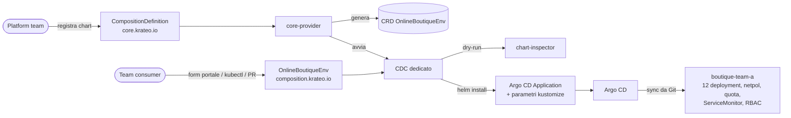

# Krateo: valutazione

## In breve

Krateo (Composable Operations) trasforma un chart Helm in un'API Kubernetes. Si registra il chart con una `CompositionDefinition`; Krateo genera una CRD dal `values.schema.json` del chart e un controller dedicato che, per ogni istanza della CRD, installa il chart con lo `spec` dell'istanza come values.

Per questa soluzione la proposta è: **il golden path è "un ambiente Online Boutique"**, esposto come API `OnlineBoutiqueEnv`. Il team consumer chiede un ambiente con pochi parametri; la piattaforma decide tutto il resto (sicurezza, rete, osservabilità, GitOps).

Raccomandazione: **non adottarlo ora per un solo servizio, preparare il terreno.** Il blueprint è già nel repo e funziona anche senza Krateo (è un chart Helm). Krateo diventa conveniente quando le richieste di ambienti diventano ricorrenti e vengono da più team.

## Come funziona (componenti verificati)

Fonte: repository `krateoplatformops/core-provider` (README e developer guide, commit di giugno 2026).

| Componente | Ruolo |
|---|---|
| **core-provider** | Osserva le `CompositionDefinition` (`core.krateo.io/v1alpha1`), scarica il chart (repo Helm, OCI o tgz), genera la CRD in `composition.krateo.io` con versione derivata da quella del chart (`0.1.0` → `v0-1-0`), avvia un controller per definizione |
| **composition-dynamic-controller (CDC)** | Uno per definizione; per ogni istanza fa `helm install/upgrade` del chart e lo riconcilia |
| **chart-inspector** | Dry-run server-side del chart per sapere quali risorse tocca: il CDC genera RBAC solo per quelle |
| Portale (Composable Portal) | UI con form generati dallo schema e widget dichiarati come risorse Kubernetes. Non incluso nella PoC: da verificare sulla documentazione ufficiale prima dell'adozione |



## Cosa diventa template / golden path

| Parte della soluzione | Nel golden path? | Note |
|---|---|---|
| Overlay dev/prod (sicurezza, NetworkPolicy, PSA, quota, ServiceMonitor, RBAC team) | **Sì, non modificabile dal consumer** | È lo standard della piattaforma; il blueprint lo riusa, non lo copia |
| Namespace, host Ingress, taglia (quota), owner, label | **Sì, parametri** | Sono le differenze legittime tra ambienti |
| Argo CD Application | **Sì, generata** | Il blueprint crea l'Application; resta GitOps |
| Pipeline CI | Non in questa fase | Per un nuovo servizio servirebbe anche la creazione del repo e dei workflow (provider git/GitHub di Krateo): è il passo successivo |
| Secret | No | Restano a script o, meglio, External Secrets; non vanno messi nei values di una Composition |
| Dashboard e alert | Già automatici | Coprono ogni namespace `boutique-*` senza configurazione per istanza |

## Parametri esposti al consumer

Definiti in [`platform/krateo/blueprint/values.schema.json`](../platform/krateo/blueprint/values.schema.json), che diventa lo schema OpenAPI della CRD: la validazione avviene all'API server, prima di qualsiasi deploy.

| Parametro | Tipo / vincolo | Effetto |
|---|---|---|
| `name` | DNS-1123, max 40 | Nome dell'Application e label `platform.homelab/service` |
| `environment` | `dev` \| `prod` | Overlay di partenza |
| `namespace` | deve iniziare con `boutique-` | Namespace di destinazione (vincolo coerente con l'AppProject) |
| `owner` | stringa | Annotation `platform.homelab/owner` su tutte le risorse |
| `tier` | `bronze` \| `silver` \| `gold` | ResourceQuota (2/3/6 CPU di request) |
| `ingress.host` | hostname | Host dell'Ingress e del certificato |
| `repository.url`, `repository.revision` | opzionali | Per testare un branch |

Volutamente **non** esposti: immagini (le decide la CI), risorse dei singoli container, NetworkPolicy, impostazioni di sicurezza. Ogni parametro in più è una possibilità di uscire dallo standard.

## Cosa potrebbe orchestrare Krateo

- **Risorse Kubernetes**: qualunque cosa sia in un chart. Qui genera solo l'Application e lascia ad Argo CD il resto: due motori di riconciliazione sugli stessi oggetti sarebbero un rischio.
- **Pipeline**: tramite provider dedicati (creazione repo, workflow) oppure lasciando le pipeline nel template del repo applicativo.
- **Database e servizi stateful**: il chart può contenere CR di operator (es. un `Cluster` CloudNativePG al posto di `redis-cart` per un servizio con DB). Krateo non sostituisce l'operator, lo parametrizza.
- **Risorse cloud**: via CR di Crossplane / ASO / ACK nel chart. Stesso principio.
- **Governance**: lo schema limita cosa si può chiedere; le label `owner` e `tier` rendono attribuibili costi e responsabilità.

## PoC, blueprint, adozione: cosa c'è davvero

| Livello | Stato | Cosa dimostra |
|---|---|---|
| **Blueprint** (chart Helm + schema) | Fatto e validato in CI: `helm lint`, `helm template`, kubeconform sull'Application, schema che rifiuta valori fuori enum/pattern | Il golden path è definibile e vincolabile anche senza Krateo |
| **Simulazione** dell'istanza | Verificato in locale: l'overlay con namespace, label e patch del blueprint produce l'ambiente atteso (`kustomize build`) | Parametri e patch sono corretti |
| **PoC Krateo** (`scripts/krateo-poc.sh`) | Script pronto: installa solo core-provider, registra la definizione (chart scaricato da `platform/krateo/dist/`), crea l'istanza `team-a`. **Da eseguire sul cluster** | Il passaggio chart → CRD → Application funziona end-to-end |
| **Adozione reale** | Non fatta | Vedi prerequisiti e rischi |

## Benefici

- Il consumer chiede un ambiente con 6 campi validati invece di copiare e modificare un overlay.
- Lo standard della piattaforma vive in un solo posto e si aggiorna per tutti (nuova versione del chart → nuova versione della CRD).
- RBAC del controller limitato a ciò che il chart crea (chart-inspector).
- Inventario: `kubectl get onlineboutiqueenvs -A` dice chi ha cosa, con owner e tier.

## Prerequisiti

- Un posto da cui Krateo scarica i chart (repo Helm, registry OCI o URL di un `.tgz`; nella PoC il pacchetto è nel repo) e un ciclo di rilascio dei chart: ogni versione del chart è una versione della CRD.
- Decidere dove vivono le istanze: nel cluster (create da portale) o in Git (create da PR e applicate da Argo CD). Per restare GitOps consiglio il secondo.
- Ownership chiara del platform team sui blueprint.
- Per il portale: autenticazione (OIDC) e mappatura gruppi → permessi.

## Limiti e rischi

- **Componente in più nel percorso critico**: core-provider, un CDC per definizione, chart-inspector, webhook di conversione con certificati gestiti. Va monitorato e aggiornato come ogni operator.
- **Doppio livello di riconciliazione** (CDC → Helm release → Argo Application → Argo CD): più indirezione nel troubleshooting. Mitigazione: il chart genera solo l'Application.
- **Evoluzione dello schema**: cambiare un campo obbligatorio è un breaking change della CRD; serve disciplina di versioning.
- **Progetto giovane** con API ancora `v1alpha1`: rischio di cambiamenti incompatibili.
- **Scala attuale**: con un'applicazione e due ambienti il costo operativo supera il beneficio.

## Quando adottarlo

1. **Ora**: blueprint come chart nel repo (fatto) e istanze come file in Git. Nessun componente nuovo.
2. **Quando** almeno 3 team chiedono ambienti, o le richieste diventano settimanali: core-provider con le definizioni in Git, istanze tramite PR.
3. **Dopo**: portale per i team non tecnici e altri blueprint (servizio nuovo con repo e pipeline, database gestito).

## Eseguire la PoC

Serve `helm` sul punto da cui si lancia lo script. Il chart è già impacchettato in `platform/krateo/dist/`; se si modifica il blueprint va rigenerato con `helm package platform/krateo/blueprint -d platform/krateo/dist` (alzando `version` in `Chart.yaml`).

```bash
scripts/krateo-poc.sh
kubectl get crd onlineboutiqueenvs.composition.krateo.io
kubectl -n krateo-system get onlineboutiqueenvs
kubectl -n argocd get application boutique-team-a
kubectl -n boutique-team-a get pods
scripts/krateo-poc.sh --cleanup      # rimuove tutto
```

Accorgimento emerso preparando la PoC: il controller di Krateo passa al chart alcuni valori propri sotto `global`. Lo schema del blueprint rifiuta i campi non previsti, quindi `global` è dichiarato esplicitamente; senza, l'installazione fallirebbe alla validazione di Helm.

Da verificare durante l'esecuzione: permessi generati per il controller (deve poter creare Application nel namespace `argocd`) e tempi di creazione della CRD.
